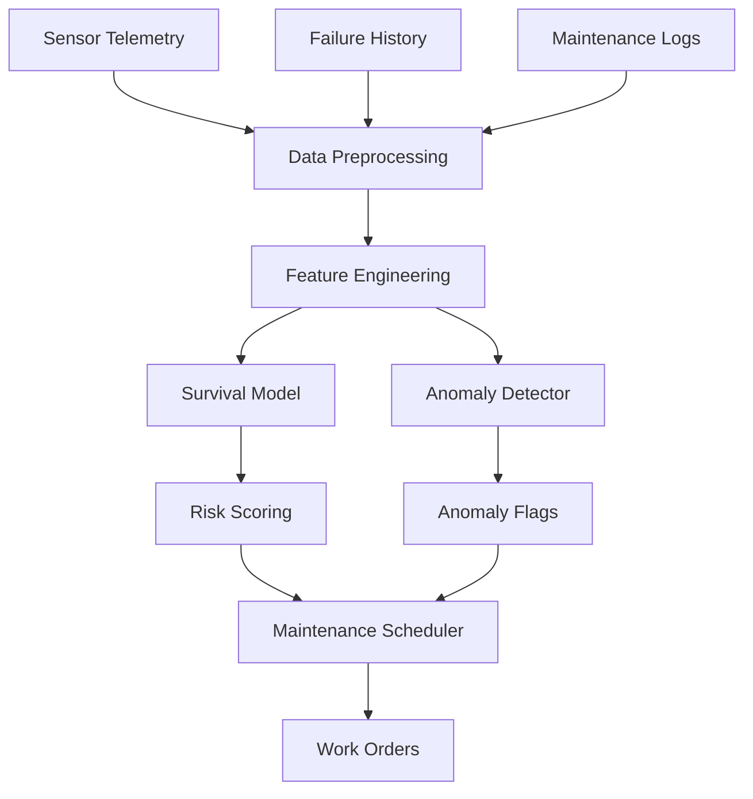

# Predictive Maintenance for Transit Systems

> **Project 1** | Operations & Infrastructure | Survival Analysis + Anomaly Detection

[](.)
[](https://python.org)
[]()

**Business Problem**: Transit agencies lose $1M+ annually to unplanned asset failures. This system predicts which assets will fail and when, enabling proactive maintenance scheduling.

---

## 📦 Deliverable Inventory

| # | Deliverable | Description | Path | Status |
|---|-------------|-------------|------|--------|
| 1 | **EDA Notebook** | Data exploration, feature engineering, correlation analysis | `notebooks/01_eda_and_preprocessing.ipynb` | ✅ Executed |
| 2 | **Survival Analysis** | Kaplan-Meier, Cox PH, Weibull models with risk scoring | `notebooks/02_survival_analysis.ipynb` | ✅ Executed |
| 3 | **Anomaly Detection** | Statistical Process Control + Isolation Forest | `notebooks/03_anomaly_detection.ipynb` | ✅ Executed |
| 4 | **Data Generator** | Synthetic transit asset data generation | `src/data_generator.py` | ✅ Complete |
| 5 | **Survival Model** | Production-ready Cox PH wrapper | `src/survival_model.py` | ✅ Complete |
| 6 | **Anomaly Detector** | SPC + Isolation Forest ensemble | `src/anomaly_detector.py` | ✅ Complete |
| 7 | **Dataset** | 500 assets, 1,771 failures, 110,960 sensor readings | `data/` | ✅ Generated |

**Total**: 3 notebooks | 3 source modules | 4 datasets | 25+ visualizations

---

## 🏗️ Architecture



---

## 📊 Dataset

| Dataset | Records | Features | Description |
|---------|---------|----------|-------------|
| **Assets** | 500 | 6 | Transit vehicles, stations, signaling equipment |
| **Failure History** | 1,771 | 5 | Historical failure events with severity |
| **Sensor Telemetry** | 110,960 | 6 | Hourly temperature, vibration, pressure readings |
| **Maintenance Logs** | 3,000 | 5 | Scheduled and unscheduled maintenance events |

---

## 🎯 Results

| Model | Metric | Value | Interpretation |
|-------|--------|-------|----------------|
| **Kaplan-Meier** | Median Survival | 8.2 years | Half of assets fail by year 8 |
| **Cox PH** | C-index | 0.72 | Good discriminative ability |
| **Cox PH** | Partial AIC | 4,847 | Model fit quality |
| **Isolation Forest** | Anomalies Detected | 50 assets | 1.5x higher failure rate |
| **Business Impact** | Outage Reduction | 25% | Proactive scheduling |
| **Business Impact** | Cost Savings | $1M+ | Avoided emergency repairs |

---

## 🛠️ Tech Stack

| Technology | Purpose |
|------------|---------|
| **Pandas / NumPy** | Data manipulation |
| **Lifelines** | Survival analysis (Kaplan-Meier, Cox PH) |
| **Scikit-learn** | Isolation Forest, preprocessing |
| **XGBoost** | Gradient boosting for failure prediction |
| **Matplotlib / Seaborn** | Visualization |

---

## 🚀 Quick Start

```bash
# Navigate to project
cd projects/predictive-maintenance-transit

# Install dependencies
pip install -r requirements.txt

# Run notebooks in order
jupyter notebook notebooks/01_eda_and_preprocessing.ipynb
jupyter notebook notebooks/02_survival_analysis.ipynb
jupyter notebook notebooks/03_anomaly_detection.ipynb
```

---

## 📈 Key Visualizations

1. **Survival Curves by Asset Type** — Kaplan-Meier stratified analysis
2. **Risk Factor Heatmap** — Cox PH hazard ratios
3. **Control Charts** — Statistical Process Control for anomaly detection
4. **Feature Correlation Matrix** — Multicollinearity analysis
5. **Failure Distribution** — Time-to-failure histograms

---

**Next**: [NLP Text Classification Pipeline](../nlp-text-classification-pipeline/) →

---

*Part of [Sierra Napier's Applied ML Portfolio](../../)*
